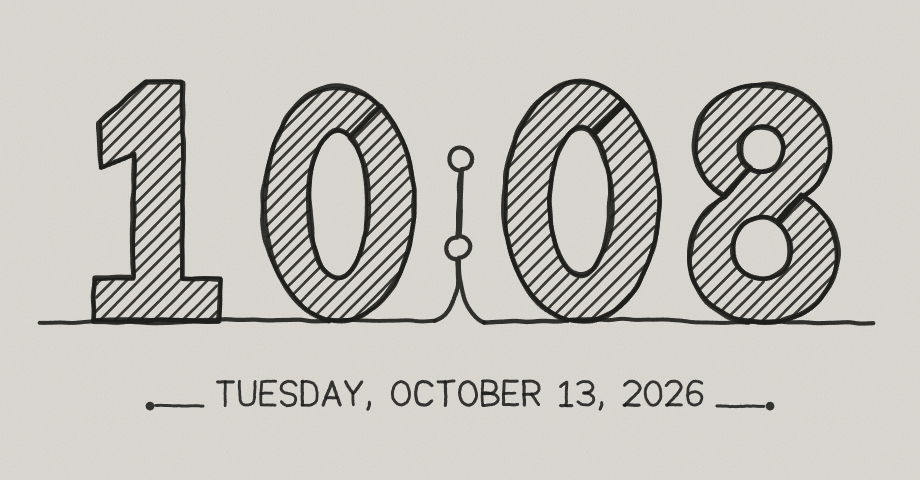

# Sketch Clock

A small Windows desktop clock where the time is drawn by one continuous,
hand-sketched pen line, with diagonal hatching, redrawn as fresh artwork
every minute.



## Run it

Requires Node.js 18+ (no internet needed after `npm install`).

```bash
npm install
npm start
```

Build a portable app folder (`dist\Sketch Clock-win32-x64\Sketch Clock.exe`):

```bash
npm run package
```

Run the tests (geometry, hatching, continuity, time/date logic, every minute of a day):

```bash
npm test
```

## Using it

- **Move**: drag anywhere on the clock. **Resize**: drag a window edge.
  Position and size are remembered.
- **Right-click** menu: Redraw now · Pause animation · Launch at Windows startup · Open settings file · Quit.
- **Keys**: `Space` pauses/resumes the drawing animation, `R` redraws now.
- The packaged app registers itself to start with Windows on first run;
  untick it in the right-click menu to stop that. `npm start` never registers itself.

## Settings

There is no settings panel. Values live in `%APPDATA%\Sketch Clock\settings.json`
(right-click > Open settings file). Edits apply live within ~2 seconds.

| key | default | meaning |
| --- | --- | --- |
| `use24Hour` | `false` | `16:37` instead of `4:37` |
| `drawDurationMs` | `3800` | main pen duration; `0` = no animation |
| `eraseDurationMs` | `650` | shake-to-clear duration |
| `dateDurationMs` | `1500` | date lettering duration |
| `passes` | `2` | laps the pen makes around each digit (1–3) |
| `lineWidth` | `1.9` | outline weight |
| `hatchSpacing` / `hatchWidth` / `hatchAngle` | `4.2` / `1.15` / `45` | stripe pattern |
| `wobble` | `1` | hand tremor; `0` = ruler straight |
| `showPen` | `true` | show the pen tip while drawing |
| `inkColor` / `paperColor` | `#1d1d1b` / `#dddbd4` | colors |

## How it works

```
src/js/
  rng.js         seeded random + smooth noise (seed = date + minute)
  format.js      time/date formatting, minute keys
  geometry.js    path-data parser, curve sampling, polygon utilities
  digits.js      custom numeral geometry 0–9 (outline + counters, 64×100 grid)
  strokefont.js  single-stroke lettering for the date
  route.js       continuous-path generator, bridges into counters, hand tremor
  hatch.js       diagonal hatching engine (exact even-odd clipping)
  artwork.js     layout/composition → complete per-minute artwork model
  renderer.js    SVG output, stroke-dash reveal
  animator.js    drawing timeline, pen, hatch sync, erase shake
  clock.js       clock manager (system clock is the source of truth)
  settings.js    settings defaults/validation
  app.js         wiring, keyboard, host events
main.js / preload.js   Electron window, menu, startup, wake/unlock resync
```

- **One line**: the pen starts on the baseline, enters each digit at its
  lowest-left point, laps the silhouette (detouring into each counter through
  a bridge that runs with the hatching), returns to the baseline and moves on.
  The colon is a tail up, two dots joined by a stem, and a tail back down.
- **Hatching** is drawn as secondary strokes. Each digit is scribbled in back
  and forth as soon as the pen finishes its first lap.
- **Timekeeping**: a timeout aimed at the next minute boundary plus a 1 s
  watchdog that compares minute keys from `new Date()`. Waking from sleep,
  unlocking or the window becoming visible triggers an immediate resync.
  Nothing counts minutes.

## Test hooks

- `src/gallery.html` (serve `src/` over HTTP) shows edge-case times; click a tile to animate it.
- `index.html?at=2026-10-13T23:59:55` runs the clock from that moment;
  `&static=1` skips animation.
- `electron . --at=<ISO time> --capture=out.png --capture-delay=6000 [--capture-size=920x480]`
  saves a screenshot and exits. It uses a throwaway profile, so it works while
  your clock is open and leaves your settings alone. The README image was made
  with `--at=2026-10-13T10:08:00 --capture=docs/screenshot.png --capture-delay=7000 --capture-size=920x480`.
